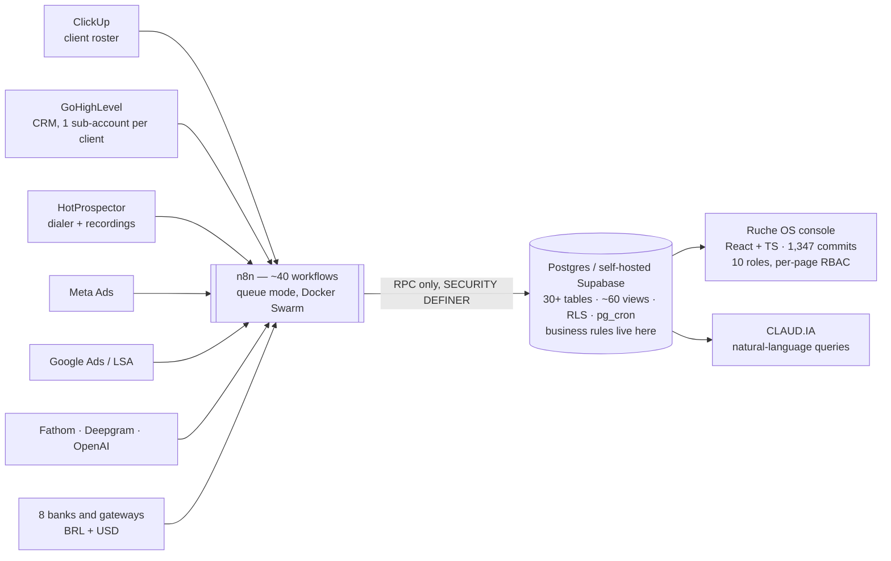

# Ruche OS — engineering case studies

**The internal operating system of a U.S. home-improvement lead-generation agency: one Postgres as
the source of truth, ~40 ingestion and automation workflows, an AI call-quality layer, a
multi-currency finance pipeline, and a React console that ten job roles used every day.**

Built in 2026 by a two-person engineering team. Decommissioned in December 2026 when the agency
closed. This repository is the written record of what was built, how it was designed, and what
production taught us — published with the company's permission.

> **No company code or data is included here.** The source lives in private repositories that stay
> with the company, and the production database held call recordings and transcripts of U.S.
> consumers. Client companies are referred to by trade and state. Figures are the ones that were
> measured in production; where a number is a point-in-time reading, it says so.

---

## The problem it solved

The agency ran paid media for roughly a hundred U.S. home-service contractors — roofing, flooring,
painting, remodeling, HVAC, decks, solar, concrete — and was paid mostly **per booked appointment**,
not per lead. That billing model is the whole reason the system exists: a cheap lead with an empty
calendar is still a failure, so every number had to survive the trip from ad click to confirmed
appointment and back to an invoice.

Before the OS, the operation was six disconnected SaaS tools. The client roster lived in ClickUp,
the CRM in GoHighLevel (one sub-account per client), dials in a HotProspector dialer, spend in Meta
and Google Ads, appointments in a Make spreadsheet, and the books in eight banks and payment
gateways across two currencies. Nobody could answer *"is client #437 profitable this month"* without
a day of manual work, and four teams each kept a private spreadsheet that disagreed with the other
three.

---

## Architecture

Three rules held the whole thing together. Every incident that came from breaking one of them is in
[`ENGINEERING-NOTES.md`](ENGINEERING-NOTES.md).

1. **The database is the source of truth — not the SaaS tools, not the front end.** Churn,
   attribution freezing and lifecycle transitions are triggers and RPCs in Postgres. A rule that
   lives in the front end is a rule four teams can disagree with.
2. **No external system writes to a table directly.** Everything goes through `SECURITY DEFINER`
   RPCs, because row-level security blocks direct `POST` and the anon key is public by design.
3. **The front end decides what to *show*; the database decides what is *allowed*.** Every sensitive
   action is re-checked inside the RPC (`is_admin()`, `is_ops()`, `is_approved()`). Page-level
   access control is a UI convenience; the real boundary is RLS.

---

## Scale, measured

| | |
|---|---|
| Console | 1,347 commits · 545 TypeScript/TSX files · ~165k lines under `src/` |
| Database | 30+ tables · ~60 views · `SECURITY DEFINER` RPCs · `pg_cron` jobs · 109 dated migrations |
| Automation | ~40 n8n workflows in queue mode, 4 services on a 3.7 GiB host |
| Access control | 10 roles, restrictive RLS on every table, per-user page overrides |
| Clients served | ~100 active contractors across U.S. home-service trades |
| AI layer | call transcription, scored audits, booking-message generation, objection classification, NL query agent |
| Finance | 10 sources, two currencies, USD functional reporting, 12-group chart of accounts |

---

## Case studies

| | What it is | Why it is interesting |
|---|---|---|
| [1 · The platform](cases/01-platform.md) | Postgres as source of truth, RLS, the two-way ClickUp sync | Field-ID mapping that survived a rename; upserts that never blank a field; per-field locks so humans beat robots |
| [2 · AI call auditing](cases/02-ai-call-auditing.md) | Dialer recording → Deepgram → scored rubric → reviewer UI | Deterministic scoring over the model's arithmetic; calibration rules written from real disagreements with the sales manager |
| [3 · Finance pipeline](cases/03-finance-pipeline.md) | 8 banks and gateways → one multi-currency journal → P&L and cash flow | Catching the source data's own rounding corruption; why FX came from the processor, not the central bank |
| [4 · Paid-media pipeline](cases/04-paid-media-pipeline.md) | Ad-level Meta and Google spend, daily, per client | An intentionally double-counted lead metric, and an API deprecation that would have broken a year of history |
| [5 · Campaign engine](cases/05-campaign-engine.md) | A form that builds a paused Meta campaign from a Drive folder | Idempotency and resume across a ten-step remote write; retryable vs. terminal failure as a product decision |
| [6 · Conversion tracking](cases/06-conversion-tracking.md) | Meta Conversions API keyed on *booked appointment*, not form fill | Optimizing for the event that actually pays, inside the attribution window |
| [7 · CLAUD.IA](cases/07-claudia.md) | Ask the database a question in plain language | A catalog in the prompt instead of a discovery round-trip; the "silent zero" failure and its fix |
| [8 · Infrastructure resilience](cases/08-resilience.md) | A watchdog and a queuing webhook relay for a flapping network | Recovering a stateful service in ~3 minutes without dropping an inbound webhook |
| [9 · Cap Ruche](cases/09-cap-ruche.md) | A browser video editor for 9:16 ad creative | A microsecond edit core, FFmpeg in a worker, word-level caption timing |

Supporting documents:

- **[`ARCHITECTURE.md`](ARCHITECTURE.md)** — the data model, the ingestion contract, and how a click
  becomes a lead becomes an appointment becomes an invoice.
- **[`ENGINEERING-NOTES.md`](ENGINEERING-NOTES.md)** — the expensive lessons. Silent truncation at
  1,000 rows, timezone bugs that moved revenue between months, a $6.77/day dedup leak, an index 16×
  larger than the data it indexed.

---

## Stack

**Data** · PostgreSQL (self-hosted Supabase), PostgREST, row-level security, `SECURITY DEFINER`
functions, materialized views, `pg_cron`, `net.http_post`

**Automation** · n8n 1.121 in queue mode (Redis), Docker Swarm, Traefik, Portainer, systemd timers

**Front end** · React, TypeScript, Vite, TanStack Router and Query, Tailwind v4, shadcn/ui, Recharts

**AI** · OpenAI `gpt-4.1` and `gpt-4.1-mini` with strict function calling, Anthropic Claude, Deepgram
nova-3 for speech-to-text, Whisper for word-level timestamps

**Integrations** · ClickUp, GoHighLevel, HotProspector, Meta Marketing and Conversions APIs, Google
Ads (GAQL), Google Local Services, Stripe, Asaas, Plaid, Make, Fathom, ZapSign, WhatsApp, Google
Sheets and Drive

**Media** · Meta Ads, Google Ads, Google Local Service Ads, server-side conversion tracking

---

## Team and role

A two-person engineering team inside the agency.

**Lucas Zuque** — architecture and data modelling; the Postgres layer (schema, RLS, RPCs, triggers,
views, migrations); the AI layer (audit rubric and calibration, booking-message generation,
objection classification, CLAUD.IA); the finance pipeline end to end; paid-media ingestion and the
campaign creation engine; infrastructure resilience; and the engineering documentation that let
anyone else work on the system.

**Letícia R.** — platform engineering, the console, and much of the ClickUp and GoHighLevel
integration surface. Workflows prefixed `[LR]` in the catalog are hers.

Media buying, customer success and call-center work was done by the agency's operating teams; the OS
is what they ran on. The audit rubric and the daily-report tiers were calibrated against the sales
manager's own judgment rather than invented in isolation — the disagreements are written up in
[case 2](cases/02-ai-call-auditing.md).

---

## Where the code is

The implementation stays in the company's private repositories: the console, the SQL repository
(schema, RPCs, triggers, views), and the n8n workflow exports. The production database is not
distributable — it holds client business data and recorded calls with U.S. consumers, which falls
under TCPA and state privacy law. Any demonstration of these modules runs on an empty schema with
synthetic seed data.

What is reproducible without the company's data, and what I am glad to walk through live: the
call-auditing design, the finance reconciliation logic, the paid-media ingestion contract, and the
conversion-tracking stack.

---

## License

The writing in this repository is released under [CC BY 4.0](LICENSE). It describes systems owned by
Ruche Digital LLC, documented here with permission for portfolio use.
